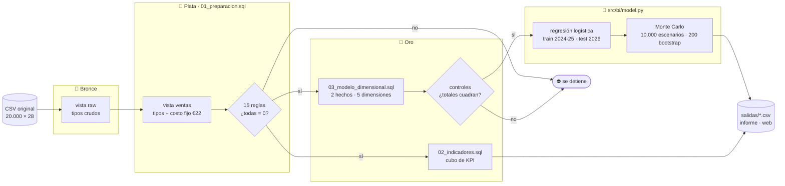
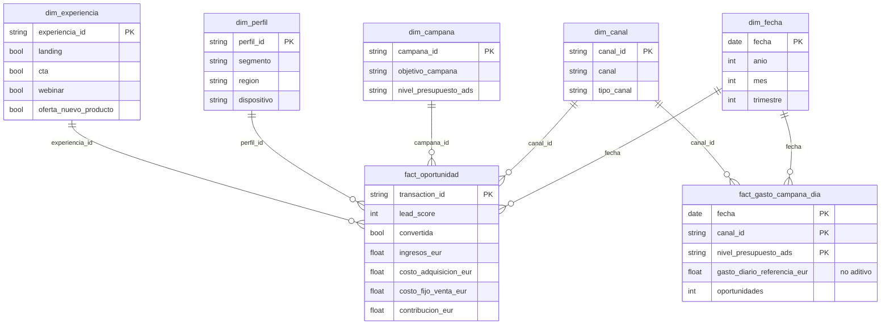

# ¿En qué invertir para crecer el próximo año?

**Proyecto integrador · Inteligencia de Negocios** · Maestría en Ciencias de la Información y las Comunicaciones, Universidad Distrital Francisco José de Caldas · 2026

Juan Felipe Rodríguez Galindo (20261595004) · Carlos Stiven Mora Hoyos (20261595003)

[](https://fozzy3.github.io/mcic-inteligencia-negocios/)
[](informe/informe.pdf)


A partir de **20.000 oportunidades comerciales** de CredCorp Capital (enero 2024 a abril 2026), el proyecto valida el dato con SQL, lo modela en estrella, calcula los KPI, estima con un modelo qué hace que una persona compre y simula 10.000 escenarios del próximo año para recomendar en qué invertir.

## Resultado

| Opción | Ganancia extra esperada (12 meses) | Prob. de perder dinero | Decisión |
|---|---:|---:|---|
| Mejorar la página de compra | +€120 mil | 0 % | ✅ Hacer ahora |
| Producto nuevo | +€175 mil | 0,1 % | 🧪 Probar primero (solo 55 ventas de evidencia) |
| Webinars | +€32 mil | 3,9 % | 🧪 Probar primero (si cuestan < €48 mil/año) |
| Duplicar publicidad | −€101 mil | 99,5 % | ⛔ No hacer |

Fuente: [`salidas/montecarlo_resumen.csv`](salidas/montecarlo_resumen.csv).

## Entregables

| | Documento | Contenido |
|---|---|---|
| 📄 | [Informe](informe/informe.pdf) | Documento completo, con el SQL en el anexo |
| 📊 | [Diapositivas](presentacion/presentacion.pdf) | Sustentación con la plantilla institucional UD |
| 🌐 | [Presentación interactiva](https://fozzy3.github.io/mcic-inteligencia-negocios/) | Recorrido tipo Prezi con 3D, animaciones y la arquitectura en AWS ([código](web/README.md)) |
| ☁️ | [Arquitectura AWS](web/aws/arquitectura-bi-aws.md) | Propuesta de despliegue en la nube ([diagrama draw.io](web/aws/arquitectura-bi-aws.drawio)) |

## Arquitectura del flujo

El proceso es **ELT** sobre DuckDB con capas **medallion**: plata y oro son vistas SQL sobre la capa anterior, así que el CSV original nunca se modifica. Si una regla de validación o un control de la estrella no da cero, `make run` se detiene.



## Modelo dimensional

Dos tablas de hechos con granos distintos: una fila por oportunidad y una por día de campaña. El gasto diario de campaña es **no aditivo**: va en su propio hecho y se promedia, nunca se suma por persona. Las tablas se exportan a [`data/modelo_dimensional/`](data/modelo_dimensional/) para Power BI.



## Cómo se ejecuta

Requisitos: [uv](https://docs.astral.sh/uv/), Python 3.12+, [tectonic](https://tectonic-typesetting.github.io/) para los PDF y Node 22 para la web.

```bash
make install     # entorno con uv
make test        # pytest: validación, KPI, estrella, crecimiento, modelo y simulación
make run         # pipeline completo: regenera salidas/, data/modelo_dimensional/ y las figuras
make db          # materializa bronce/plata/oro con PK y FK en data/bi.duckdb (para DBeaver)
make pdf         # compila informe y diapositivas
make web         # presentación interactiva en http://localhost:5173
```

`make pdf` copia Times New Roman y Cambria desde el manual de marca UD a `fuentes/`, que no se versiona. Si el manual está en otra ruta: `make pdf MARCA=/ruta/al/manual`.

## Estructura

```text
├── sql/
│   ├── 01_preparacion.sql          vista limpia y 15 reglas de validación
│   ├── 02_indicadores.sql          cubo de KPI, crecimiento 12m vs 12m, saturación de publicidad
│   └── 03_modelo_dimensional.sql   esquema estrella y sus controles
├── src/bi/
│   ├── pipeline.py                 orquesta todo y se detiene si un control falla
│   ├── model.py                    regresión logística, bootstrap y Monte Carlo
│   ├── db.py                       capas medallion en DuckDB (make db)
│   └── plots.py                    figuras del informe
├── tests/test_bi.py
├── data/
│   ├── original/                   CSV del caso, solo lectura
│   └── modelo_dimensional/         hechos y dimensiones en CSV
├── salidas/                        resultados que cita el informe
├── informe/  presentacion/         fuentes LaTeX y PDF
└── web/                            presentación interactiva (Vite + three.js + GSAP)
```

## Decisiones de ingeniería

- **El dato original es inmutable.** Toda la limpieza vive en vistas SQL, y el pipeline se puede volver a correr de principio a fin con los mismos números.
- **Sin fuga de información.** Las columnas que solo se conocen después de la venta (valor, días de cierre, margen) quedan fuera del modelo con una lista explícita en `model.py`.
- **Validación temporal.** El modelo aprende con 2024-2025 y se evalúa con 2026, que no vio: AUC 0,745, y el 20 % mejor puntuado concentra el 43 % de las compras.
- **Trazabilidad.** Cada número del informe cita la vista o el archivo de `salidas/` del que sale.
